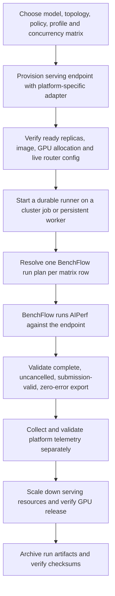

# AgentX benchmark reproducibility

Portable scripts and instructions for running the AgentX inference workload with BenchFlow and AIPerf. The repository contains no benchmark results, logs, credentials, cluster exports, or local-machine paths.

## Scope

The runner is device-neutral: it sends the same configured workload to an OpenAI-compatible endpoint and validates AIPerf's exported result. A platform operator must provision the model-serving topology and routing policy first. Kubernetes APIs, GPU allocation, model storage, TLS, and GPU telemetry vary by platform; this repository does not pretend one deployment manifest works for all of them.

The checked-in 30-minute profile and example configuration describe the Qwen3.8-27B AgentX experiment. Model, runtime image, tensor-parallel size, replica count, endpoint, and concurrency matrix are editable settings. The selected duration must match the pinned BenchFlow profile; changing it requires a profile revision in the pinned checkout and a matching profile copy in this repository.

## End-to-end flow



BenchFlow launches AIPerf; the script does not call AIPerf directly. AgentX concurrency is the number of live session trees, including subagents, rather than a count of users.

## Quick start

Requirements: Bash, Python 3, Git, BenchFlow (`bflow`), and access to a ready endpoint. Run the benchmark worker inside a durable environment for long profiles; closing a laptop terminal should not own the lifetime of a multi-hour sweep.

1. Clone this repository and the BenchFlow fork. Check out the commit recorded in `config/run.env.example` (or the commit approved for your experiment).
2. Copy `config/run.env.example` to `config/run.env`; edit it for your environment. Never put credentials in this file.
3. Edit the tab-separated matrix in `config/matrix-agentx.example.tsv`, or point `MATRIX_FILE` at your own matrix. Each invocation uses one serving topology and processes rows serially.
4. Provision the topology and EPP with your platform's reviewed deployment workflow. Verify that the effective router configuration matches the policy before benchmarking. In particular, an input `scheduler: {}` does not prove that the generated EPP is using an empty plugin set; inspect the live scheduler.
5. Start `scripts/run-benchflow-matrix.sh` from a durable runner with the edited config path.
6. Review each case's run plan, BenchFlow log, AIPerf export, validation log, and independently collected telemetry. A passing Kubernetes Job or healthy endpoint alone is not a valid benchmark.
7. Scale down the serving service, confirm GPU resources are released, and archive the run directory to the approved durable store with checksums.

Example:

```bash
cp config/run.env.example config/run.env
# Edit config/run.env and the matrix before running.
bash scripts/run-benchflow-matrix.sh config/run.env
```

The output root is configured in `run.env`; the runner refuses to reuse an existing run ID. Outputs are ignored by Git.

## Matrix format

`case_id`, `policy`, and `concurrency` are tab-separated columns. Supported policies are:

- `agentic`: sends `EPP-Profile: agentic` and enables the AgentX session-ID correlation setting in the resolved AIPerf plan.
- `no_default`: sends no EPP profile header. The endpoint must already have the intended `scheduler: {}` configuration, and the live generated EPP must be checked independently. This policy name does not configure the server.

Do not substitute weighted Agentic results for `no_default`. If your platform transforms the scheduler configuration, stop and resolve that before measuring.

## What is and is not automated

| Step | Included here |
|---|---|
| BenchFlow plan resolution and serial execution | `scripts/run-benchflow-matrix.sh` |
| AIPerf result validity gate | `scripts/validate_aiperf.py` |
| NVIDIA DCGM plus per-pod vLLM scraper from the captured run | `adapters/nvidia/metrics-sampler.py` (optional; NVIDIA/OpenShift-specific) |
| Creating a model service, assigning devices, configuring EPP, TLS and storage | Platform-specific; use the platform's reviewed deployment workflow |
| Uploading to S3 or another archive | Deliberately not automated; configure your approved identity and no-overwrite policy |

The example matches the captured run's `no_server_metrics=true` setting. It defaults AIPerf TLS verification to enabled even though the archived profile sets it to false; the source run targeted an HTTP endpoint, so that setting did not affect its traffic. For HTTPS endpoints, keep verification enabled and provide the platform CA when needed. The NVIDIA sampler records raw vLLM and DCGM exposition and scrape status, separately from AIPerf result validation. Other devices need their own telemetry adapter; do not interpret missing telemetry as zero utilization.

## Validity gate

The AIPerf `profile_export_aiperf.json` must report all of the following:

- `is_complete: true`
- `was_cancelled: false`
- `metadata.submission_valid: true`
- `metadata.scenario: inferencex-agentx-mvp`
- positive `request_count`
- matching `completed_request_count`
- zero `error_request_count` and `request_error_rate`

The runner stops at the first invalid case and preserves its output for diagnosis. It does not retry a case or continue the queue automatically, avoiding accidental duplicate measurements.

## Repository contents

- `config/`: editable, non-secret run settings and a small example matrix.
- `profiles/`: the AgentX profile used by the captured Qwen3.8 run.
- `scripts/`: serial BenchFlow runner and AIPerf validity checker.
- `adapters/nvidia/`: optional NVIDIA-specific Prometheus/DCGM sampler.
- `tests/`: a small synthetic check for the validity gate; no measured output is included.

## Provenance

The profile and optional NVIDIA sampler were taken from the archived successful Lenovo AgentX run. The full historical launcher was not copied: it embeds Lenovo namespace, service, route, PVC, model-cache, node, and cluster assumptions. This repository replaces that environment-specific launcher with a configurable benchmark runner and clearly leaves serving deployment to a platform adapter.
